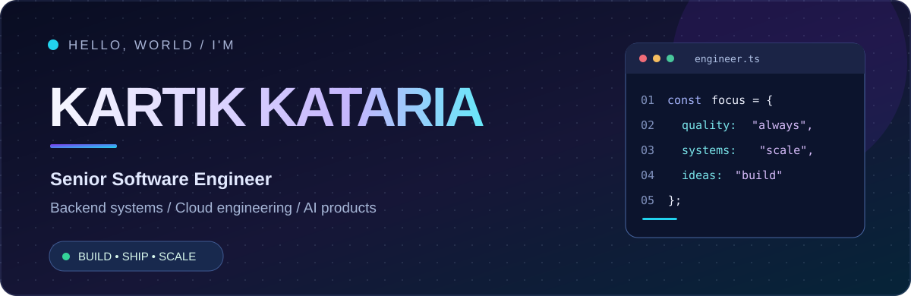
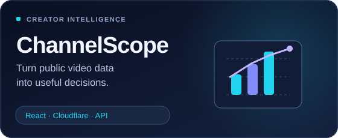
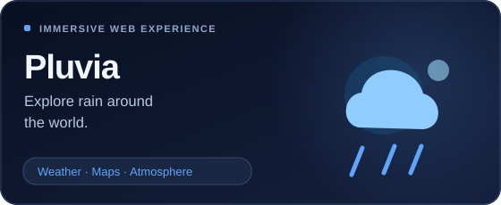
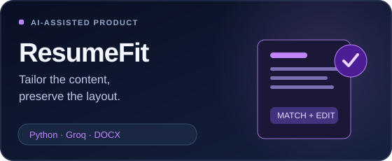
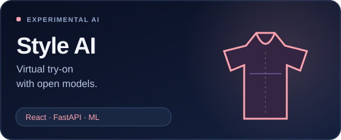

 

  

---

### 01 / About me

I'm a **Senior Software Engineer** focused on building reliable, maintainable software — from backend APIs and distributed systems to intuitive, useful products.

- **At work:** API design, distributed services, AWS, performance engineering and observability.
- **Outside work:** shipping independent projects where web engineering, data, AI and creativity meet.
- **How I build:** thoughtful architecture, simple experiences and a fast feedback loop.

> **I enjoy the space between a difficult engineering problem and a polished, useful product.**

### 02 / Featured projects

| Project | What it does | Explore |
| :--- | :--- | :--- |
| **ChannelScope** | Creator intelligence with public YouTube analytics, channel comparisons and actionable insights | [Live app](https://channelscope.kartikkataria2000.workers.dev/) · [Source](https://github.com/kartik977/youtube-channel-intelligence) |
| **Pluvia** | An immersive, city-based rain experience blending visual atmosphere and ambient sounds | [Live experience](https://kartik977.github.io/pluvia/) |
| **ResumeFit** | AI-assisted resume tailoring with an emphasis on preserving the original document format | [Source](https://github.com/kartik977/AI-Job-Hunter/tree/main/tools/resumefit) |
| **Style AI** | A virtual fitting-room experiment powered by open-source try-on models | [Source](https://github.com/kartik977/Style-AI) |

Also building with data: <a href="https://github.com/kartik977/etl-command-center">ETL Command Center</a> · <a href="https://github.com/kartik977?tab=repositories">More projects</a>

### 03 / Tech I work with

**Languages & frameworks**

**Cloud, data & infrastructure**

### 04 / GitHub activity

Activity card generated by a third-party service. My <a href="https://github.com/kartik977">GitHub contribution graph</a> is always available on this profile.

### 05 / Beyond the code

I like building products that mix **engineering + creativity** — from immersive web experiences to creator tools and practical AI applications. I care about how well-designed systems make ambitious ideas feel effortless.

**Have an interesting project or engineering problem?**

[**Explore my portfolio**](https://kartik977.github.io/) &nbsp;·&nbsp; [**Browse all repositories**](https://github.com/kartik977?tab=repositories)

 

Crafted with curiosity, coffee and a commitment to shipping useful things.

